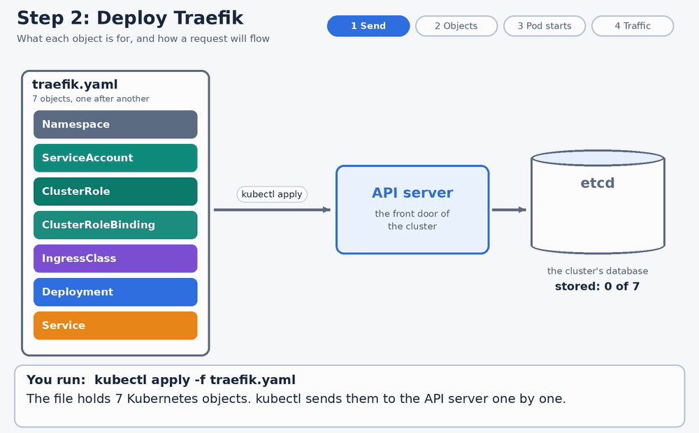

# Kubernetes Ingress with Traefik

## What Step 2 deploys, what each piece does, and how a request flows

> **Status: written before the first run.** Nothing in this guide has been executed on the cluster yet. Every output shown is **Expected**, a prediction, and none is **Observed**, apart from the few facts listed under *Observed so far* in Section 13. The manifests were checked with a YAML parser and the RBAC rules were compared with Traefik's own documentation, but a manifest that parses can still fail on a real cluster. After the labs are run, the *Expected* blocks should be replaced with real output, and the "What is verified" section updated.



*The animation above (`traefik-step2-flow.gif`) walks through Sections 5 to 8: the 7 objects, how a Pod appears, and the path of a request.*

**Contents**

1. What problem does this solve?
2. Two halves: the Ingress and the controller
3. Why Traefik, and why this exact version
4. The lab at a glance
5. The seven objects in `traefik.yaml`
6. What happens when you run `kubectl apply`
7. Step 3: two test apps and an Ingress
8. How one request flows
9. Security: what the controller can read
10. How to run it
11. When something goes wrong
12. Glossary
13. What is verified, and what is not
14. Clean up
15. Where the facts came from
- Appendix A: `traefik.yaml`
- Appendix B: `apps.yaml`

---

# 1. What problem does this solve?

The Services guide exposed an application with a **NodePort** Service: one port on every node, leading to one Service. That works for a test, and it gets awkward quickly:

| With NodePort alone | The difficulty |
|---|---|
| One port per application | `30080` for one app, `30081` for the next, and everyone has to remember which |
| No names | A client types an address and a port, never `shop.example.com` |
| No paths | Nothing can send `/api` to one application and `/` to another |

An **Ingress** adds one entrance for HTTP traffic, with **rules** that choose the destination from the request itself: the **Host** header (the name in the address) and the **path**. In this lab, a request for `whoami.lab` goes to one application and a request for `web2.lab` goes to another, through the same port.

---

# 2. Two halves: the Ingress and the controller

| Piece | What it is | Who provides it |
|---|---|---|
| **Ingress** | An API object holding routing rules | Kubernetes (built in) |
| **Ingress controller** | A program that reads those rules and actually moves the traffic | **You install one** |
| **IngressClass** | An API object naming which controller handles which Ingress | You create it |

Kubernetes defines the first half and does not ship the second. **An Ingress with no controller does nothing**: the object is accepted and stored, and no traffic is ever routed. Step 2 of the lab installs the controller. Step 3 creates the Ingress.

---

# 3. Why Traefik, and why this exact version

The usual tutorial controller is **ingress-nginx**, and it was not used here. These facts come from the sources in Section 15, consulted on October 15, 2026:

| Finding | Detail |
|---|---|
| **ingress-nginx is retired** | The Kubernetes project announced its retirement in November 2025. Best-effort maintenance ended in March 2026, and its repository was archived read-only on **March 24, 2026**, with no further releases or security fixes. Critical vulnerabilities were reported after that. Existing installations keep working, and nothing patches them |
| **The Ingress API is not retired** | Only that one controller is. The Ingress API stays supported, though its development is frozen, and **Gateway API** is its successor. The project's own statement says none of the alternatives is a drop-in replacement |
| **Traefik was chosen** | It is maintained, installs from plain YAML (no Helm needed), and the official image is **about 52 MB compressed** on Docker Hub. Docker Hub pulled quickly for this cluster earlier (busybox, nginx), while `registry.k8s.io` pulls ranged from 2 seconds to over 4 minutes for small images |
| **The version is pinned to `v3.7.12`** | Traefik **v3.7.9**, the version the documentation examples and the Helm chart default to, falls inside the range of a published vulnerability: a **ForwardAuth identity spoofing** issue through a dot-form header alias, affecting v3.0.0 up to 3.7.11 and fixed in **v3.7.12**. The advisory (recorded as CVE-2026-88011 and CVE-2026-88879 in the OSV database) was published on September 10, 2026, so v3.7.12 is more than five weeks old |
| **The fix is opt-in** | The fix adds an entry-point option, `aliasHeadersStrategy`, whose default keeps the old behaviour, and which must be set to `delete` or `reject` to take effect. **It is not set in this lab**: the lab doesn't use ForwardAuth, and I haven't verified the option's exact flag name, since a wrong flag would stop Traefik from starting |
| **The test image** | `traefik/whoami:v1.11`, about 3 MB (2.9 MiB were fetched in the first real pull): a tiny web server that prints the request it received, so you can see exactly what the Ingress did |

**Docker Hub carries the `v3.7.12` tag:** observed, see Section 13. (Had it not, the fallbacks would have been `v3.7.13` or `v3.7.11`, and the latter has the known issue.)

---

# 4. The lab at a glance

| Step | What it does | Where |
|---|---|---|
| **1** | Pre-pull the two images onto both workers, which also tests the tag | PowerShell |
| **2** | Deploy Traefik: 7 objects, in the namespace `traefik` and cluster-wide | Master shell |
| **3** | Deploy two test apps and an Ingress that routes by host name | Master shell |
| Later | Path routing, `pathType`, the 404 against 503 difference, TLS with a self-signed certificate, and a Gateway API version | (planned) |

Requests are sent to the master's **fixed address**, `172.25.246.7`, since it never changes (the address-change guide explains why that matters), on **NodePort 30080**. The host names (`whoami.lab`, `web2.lab`) are not in any DNS. The lab sends them in a `Host:` header with `curl -H`, which is all the Ingress looks at.

---

# 5. The seven objects in `traefik.yaml`

Seven objects, applied together. Three live inside the `traefik` namespace, and **three are cluster-wide** (they belong to no namespace). The seventh is the namespace itself. The full file is in Appendix A. Each object below is shown with comments, and the script that built this guide checked that every excerpt equals the object in the real file.

## 5.1 Namespace: a labelled folder

```yaml
apiVersion: v1
kind: Namespace
metadata:
  name: traefik
```

Traefik's own objects go in the folder `traefik`, apart from the test apps in `ingress-lab`.

## 5.2 ServiceAccount: the Pod's identity

```yaml
apiVersion: v1
kind: ServiceAccount
metadata:
  name: traefik-ingress-controller
  namespace: traefik
```

A ServiceAccount is the identity (think ID card) a Pod uses when it talks to the Kubernetes API. Traefik has to call the API constantly: to find Ingresses, Services and Pod addresses. The Deployment says `serviceAccountName: traefik-ingress-controller`, and Kubernetes mounts that identity's token into the Pod.

## 5.3 ClusterRole: a list of allowed actions

```yaml
apiVersion: rbac.authorization.k8s.io/v1
kind: ClusterRole
metadata:
  name: traefik-ingress-controller
rules:
- apiGroups: [""]                      # the core API group
  resources: ["services", "secrets", "nodes"]
  verbs: ["get", "list", "watch"]
- apiGroups: ["discovery.k8s.io"]
  resources: ["endpointslices"]
  verbs: ["get", "list", "watch"]
- apiGroups: ["extensions", "networking.k8s.io"]
  resources: ["ingresses", "ingressclasses"]
  verbs: ["get", "list", "watch"]
- apiGroups: ["extensions", "networking.k8s.io"]
  resources: ["ingresses/status"]
  verbs: ["update"]
```

| Rule | In plain words |
|---|---|
| `services`, `secrets`, `nodes`: get, list, watch | Read Services (to find where traffic can go), **Secrets** (TLS certificates) in **every** namespace, and the cluster's **Nodes**. Traefik's Kubernetes provider discovers cluster-scoped resources, `IngressClass` and `Nodes`, by default (its documentation says so), and **without this rule it never loads a single route** (observed, Section 13). The option `disableClusterScopeResources` would remove the need, but then Ingresses that use an IngressClass are ignored, and ours do |
| `endpointslices`: get, list, watch | Read which Pod addresses currently stand behind each Service |
| `ingresses`, `ingressclasses`: get, list, watch | Read the routing rules, and which controller each one is meant for |
| `ingresses/status`: update | Write an address back into an Ingress's status |

`watch` means the controller is **told about changes** as they happen, instead of asking repeatedly. That is why a new Ingress takes effect almost at once. A ClusterRole is cluster-wide, so it sits outside the namespace. **The `nodes` rule was missing from the first version of this file.** It copied the rules from the Traefik documentation page I read, which does not list `nodes`, and the first real run showed that Traefik v3.7.12 needs it: its log filled with `nodes is forbidden`, and every host got a 404 (Section 13). I had in fact included `nodes` in my first draft, from memory, and removed it after comparing with the page. The comparison proved that the file matched the page, which is not the same as the page being complete.

## 5.4 ClusterRoleBinding: handing the permissions over

```yaml
apiVersion: rbac.authorization.k8s.io/v1
kind: ClusterRoleBinding
metadata:
  name: traefik-ingress-controller
roleRef:                               # which list of permissions
  apiGroup: rbac.authorization.k8s.io
  kind: ClusterRole
  name: traefik-ingress-controller
subjects:                              # who receives them
- kind: ServiceAccount
  name: traefik-ingress-controller
  namespace: traefik
```

A role by itself grants nothing. The RBAC guide showed that a role has no effect until a binding connects it to a subject. Without this object the ServiceAccount's permissions would be empty, and Traefik could not see a single Ingress.

## 5.5 IngressClass: the name tag

```yaml
apiVersion: networking.k8s.io/v1
kind: IngressClass
metadata:
  name: traefik
spec:
  controller: traefik.io/ingress-controller
```

An Ingress says `ingressClassName: traefik` to state which controller should handle it, and this object says who that is. Traefik's documentation says that for an Ingress with `ingressClassName`, it looks for an IngressClass whose controller is `traefik.io/ingress-controller`, and the real run confirmed it: an Ingress with `ingressClassName: traefik` was picked up. (I first wrote this string from memory, and it turned out to be right.)

## 5.6 Deployment: the recipe for the Pod

```yaml
apiVersion: apps/v1
kind: Deployment
metadata:
  name: traefik
  namespace: traefik
  labels:
    app: traefik
spec:
  replicas: 1
  selector:
    matchLabels:
      app: traefik
  template:
    metadata:
      labels:
        app: traefik                   # the Service finds the Pod by this label
    spec:
      serviceAccountName: traefik-ingress-controller
      containers:
      - name: traefik
        image: traefik:v3.7.12
        args:
        - --providers.kubernetesingress
        - --entryPoints.web.address=:8000
        - --entryPoints.traefik.address=:8080
        - --ping=true
        - --accesslog=true
        - --log.level=INFO
        ports:
        - name: web
          containerPort: 8000
        - name: traefik
          containerPort: 8080
        readinessProbe:
          httpGet:
            path: /ping
            port: traefik
          periodSeconds: 5
        livenessProbe:
          httpGet:
            path: /ping
            port: traefik
          periodSeconds: 10
          failureThreshold: 3
        resources:
          requests:
            cpu: 50m
            memory: 64Mi
```

| Setting | What it means |
|---|---|
| `replicas: 1` | One copy of Traefik. Fine for a lab, and a single point of failure otherwise |
| `image: traefik:v3.7.12` | The pinned version (Section 3) |
| `serviceAccountName` | The identity from 5.2, and with it the permissions from 5.3 and 5.4 |
| `--providers.kubernetesingress` | Turns on reading Kubernetes **Ingress** objects. A *provider* is a source of routing rules |
| `--entryPoints.web.address=:8000` | Defines an entry point named `web`, listening on port 8000 **inside the Pod**. Port 8000 is above 1024, so no special privilege is needed to bind it |
| `--entryPoints.traefik.address=:8080` | An internal entry point named `traefik`, which hosts the health endpoint |
| `--ping=true` | Enables the `/ping` health endpoint |
| `--accesslog=true` | Prints one log line per request to the container's output, readable with `kubectl logs` |
| `--log.level=INFO` | Normal logging |
| `readinessProbe` on `/ping` | Every 5 seconds. A failing Pod is **removed from the Service's endpoints** (the probes guide's readiness mechanism) |
| `livenessProbe` on `/ping` | Every 10 seconds. After 3 failures the container is restarted |
| `requests: 50m, 64Mi` | What the scheduler reserves for the Pod. There are no limits, so its QoS class is Burstable (the scheduling guide) |

The Pod has **no toleration** for the control-plane taint, so it cannot land on the master. It will run on a worker.

## 5.7 Service: the stable door

```yaml
apiVersion: v1
kind: Service
metadata:
  name: traefik
  namespace: traefik
spec:
  type: NodePort
  selector:
    app: traefik
  ports:
  - name: web
    port: 80              # the Service's own port
    targetPort: web       # the container port named "web", which is 8000
    nodePort: 30080       # the port opened on every node
```

| Number | Who uses it |
|---|---|
| **30080** (`nodePort`) | Clients outside the cluster, on any node's address |
| **80** (`port`) | Other things **inside** the cluster, which would call `traefik.traefik:80` |
| **8000** (`targetPort: web`) | The container, reached through the named port |

The Service finds Traefik's Pod through the label `app: traefik`. `30080` sits in the NodePort range (30000 to 32767) and doesn't collide with the existing `nginx` Service on `31260`. The `nodePort` is fixed here, so the address in the commands doesn't change from run to run.

---

# 6. What happens when you run `kubectl apply`

The same steps happen for every Deployment. The probes, scheduling, RBAC and NodePort mechanics appeared in earlier guides, with real output, and are noted where they apply. The rest is the standard Kubernetes behaviour that this lab will confirm or contradict.

| # | Who acts | What happens |
|---|---|---|
| 1 | **kubectl, API server, etcd** | `kubectl` sends the 7 objects. The API server checks them and stores them in etcd. Nothing runs yet |
| 2 | **Deployment controller** | Sees the new Deployment and creates a **ReplicaSet** |
| 3 | **ReplicaSet controller** | Creates the **Pod** object, a record with status Pending |
| 4 | **Scheduler** | Picks a node. The master's taint rules it out, so a worker is chosen (the scheduling guide) |
| 5 | **kubelet and containerd** | The node's kubelet sees the Pod, and containerd starts the container from the image, which the pre-pull in Step 1 already cached |
| 6 | **kubelet** | Probes `GET /ping` on port 8080. When it answers, the Pod becomes **Ready** (the probes guide) |
| 7 | **EndpointSlice controller** | Lists the Ready Pod's address in the Service's endpoints |
| 8 | **kube-proxy** | On **every** node, programs port 30080 to forward to the Service and then to the Pod (the Services guide) |
| 9 | **Traefik itself** | Starts, authenticates with its ServiceAccount token, and begins to watch Ingresses, IngressClasses, Services, EndpointSlices, Secrets and Nodes (if any one of these watches fails, it loads no routes at all: Section 13) |

At this point **no Ingress exists**, so Traefik's routing table is empty. A request to the door should therefore be answered by Traefik itself with a **404**, which is a useful check that the door works before any application exists (Section 10).

---

# 7. Step 3: two test apps and an Ingress

`apps.yaml` (Appendix B) creates the namespace `ingress-lab` with:

| Object | What it is |
|---|---|
| Deployment `whoami` (2 replicas) and Service `whoami` | A web server that prints the request it received, with two Pods so you can watch the load being shared |
| Deployment `web2` (1 replica, started with `--name=app-two`) and Service `web2` | The same server, printing `Name: app-two`, so you can tell the two apps apart |
| Both Deployments have a readiness probe on `/health` | A Pod receives traffic only when it reports healthy |
| Ingress `host-routing` | The rules, below |

```yaml
apiVersion: networking.k8s.io/v1
kind: Ingress
metadata:
  name: host-routing
  namespace: ingress-lab
spec:
  ingressClassName: traefik            # handled by the controller named in the IngressClass
  rules:
  - host: whoami.lab                   # requests whose Host header is whoami.lab ...
    http:
      paths:
      - path: /
        pathType: Prefix               # ... and whose path starts with /
        backend:
          service:
            name: whoami               # ... go to the Service whoami, port 80
            port:
              number: 80
  - host: web2.lab
    http:
      paths:
      - path: /
        pathType: Prefix
        backend:
          service:
            name: web2
            port:
              number: 80
```

An Ingress points at **Services**, never at Pods. Traefik uses the Service only to find the Pods' addresses (from the EndpointSlices), and then talks to those Pods directly.

---

# 8. How one request flows

For `curl -H 'Host: whoami.lab' http://172.25.246.7:30080/`:

| # | Where | What happens |
|---|---|---|
| 1 | **The Ingress** (before any request) | Traefik has already learned the rule from the API server and built its routing table |
| 2 | **NodePort 30080** | The request reaches port 30080 of the master. kube-proxy opened it on every node, so any node's address would work |
| 3 | **Service `traefik`** | kube-proxy forwards to the Service, which picks a Ready Traefik Pod and sends the request to its port 8000 (the Service maps port 80 to `targetPort: web`) |
| 4 | **Traefik** | Reads the `Host` header, finds `whoami.lab` in its routing table, and chooses the Service `whoami` |
| 5 | **A `whoami` Pod** | Traefik sends the request to one of the Pod addresses behind `whoami`, alternating between the two |
| 6 | **The reply** | Travels back along the same path |

What the answers mean:

| Response | Meaning |
|---|---|
| The `whoami` page (hostname, headers) | The route worked |
| **404** `404 page not found` | **No rule matched** the Host and path. Traefik answered itself, and no Pod was involved |
| **503** | A route exists, but its Service has no servers. **With Traefik's default settings, a Service with no ready Pods gets no route at all, so the answer is a 404, not a 503** (observed in the errors lab, `ingress-errors-lab.md`; the provider option `allowEmptyServices` changes this). A 503 was seen only for about 2 seconds after a working app was scaled to 0, and then it became a 404. With `allowEmptyServices` on, the 503 is permanent (observed, with the body `no available server`) |
| **502** | A rule matched, a Pod address was chosen, and **the connection to it failed** |

The 404 and 502 behaviour has been observed (the errors lab): a 404 when no route matches, and a **502** when a Service's `targetPort` has nothing listening, with the failed port visible in Traefik's access log. The 503 is the surprising one: see the row above.

**Two things to look for in the page.** Traefik adds `X-Forwarded-*` headers (host, protocol, server) and `X-Real-Ip`. The client address in them is probably a `10.244.x.x` address and **not yours**: a request that enters on one node's NodePort and leaves toward a Pod on another node has its source address rewritten on the way (the Service's default traffic policy), so the real client address is lost. Keeping it needs `externalTrafficPolicy: Local`, which this lab doesn't use. That is an inference from how NodePort works.

---

# 9. Security: what the controller can read

The ClusterRole in 5.3 includes **`get`, `list` and `watch` on `secrets` in every namespace**. That is Traefik's documented RBAC, and it is why a TLS Secret in any namespace can be used by an Ingress. It is also a very wide permission:

| Fact | Where it was shown |
|---|---|
| `list` on Secrets returns **every whole object, values included** | The Secrets guide, with a ServiceAccount allowed only to `list` |
| Anyone who controls Traefik's Pod, or its ServiceAccount token, can read every Secret in the cluster | A consequence of the two facts above |

The lab checks it with a read-only command (Section 10):

```bash
kubectl auth can-i list secrets -A --as=system:serviceaccount:traefik:traefik-ingress-controller
```

The expected answer is `yes`. Traefik's documentation has a section on multi-tenant Kubernetes clusters, which I saw in its navigation and **did not read**, so I can't say what mitigations it recommends. For a lab with no tenants the permission is acceptable. In a shared cluster it deserves a deliberate decision.

The version choice is the other security point: v3.7.12 includes the fix for the ForwardAuth header issue, and the option that activates it is **not** enabled here (Section 3).

---

# 10. How to run it

## The shortcut: one script

`ingress-lab.sh` (in `scripts/`) does Steps 2 and 3 and every check in this section, in one go, and **it is safe to run again and again**: a second run prints `unchanged` and changes nothing.

```powershell
multipass transfer ingress-lab.sh master:/home/ubuntu/
multipass exec master -- bash /home/ubuntu/ingress-lab.sh            # set up and check
multipass exec master -- bash /home/ubuntu/ingress-lab.sh status     # check only, change nothing
multipass exec master -- bash /home/ubuntu/ingress-lab.sh down       # remove everything
multipass exec master -- bash /home/ubuntu/ingress-lab.sh reset      # remove everything, then set it up again from a clean start
```

| It checks first | And stops, before changing anything, if |
|---|---|
| Whether both image tags exist on Docker Hub (a `HEAD` request, nothing is downloaded) | A tag is missing. The message names the variable to change, such as `TRAEFIK_VERSION=<tag>` |
| Whether NodePort 30080 is free, or already this lab's | Another Service uses it |

It then applies the manifests, waits for each Deployment with a progress line (so a slow image pull is visible, not silent), gives up early if an event says an image can't be found, and finishes with `PASS` or `FAIL` for each check, in the same style as `flannel-recover.sh`. Settings can be overridden with environment variables (`TRAEFIK_VERSION`, `WHOAMI_VERSION`, `NODEPORT`, `LAB_IP`, `ROLLOUT_TIMEOUT`), and `render` prints the manifests. `down` lists what exists, deletes it, and checks that all seven objects are gone: the five the lab creates, **and the temporary `traefik-nodes-reader` ClusterRole and binding** if they were made by hand while diagnosing the missing `nodes` permission. `reset` runs `down` and then `up`, and **stops without applying anything** if the cleanup doesn't finish (a namespace still terminating would make the apply fail confusingly). `DELETE_TIMEOUT` (default 120 s) sets how long it waits.

It does **not** do Step 1's pre-pull, because that needs `multipass exec` on the Windows host, and the master can't reach the workers. Without it, the kubelets pull the images when the Pods start, and the script waits. Run Step 1 first if you want the pull out of the way.

**What was tested:** the script ran against a fake `kubectl` and `curl` in 26 scenarios (a fresh setup, a second run, `status`, a missing tag, a taken NodePort, an unreachable registry, a `NotReady` worker, `down` twice, an unreachable API, a Deployment that never starts, an image that cannot be found, warnings, routes that never appear, the overrides, `reset` (with the hand-made role present, on an empty cluster, and with a deletion that never finishes), the timing of the first clean run (`web2` and the second `whoami` Pod appearing late), and **a reproduction of the failure the first real run hit**: `nodes` forbidden, the client-go error lines, and every host answering 404), and `render` reproduces the two manifests in the appendices byte for byte. **The first version ran on the real cluster**, which is how the missing `nodes` permission was found (Section 13), and its Docker Hub check worked there. **The `reset` version ran there too: a clean start, then a second run that printed `unchanged` throughout (Section 13). The latest version, which polls instead of checking once, also ran there from a clean start and passed all 19 checks (Section 13).** It now checks that Traefik's ServiceAccount can list everything it watches, treats `forbidden` in Traefik's log as a failure when the routes don't work (and only as a warning when they do, since old errors stay in the log after a fix), keeps checking after a routing failure, and prints the Ingress description and the Traefik log by itself when a route doesn't appear.

The sections below describe each step by hand, which is also what the script does.

## Step 1: pre-pull the images (PowerShell)

```powershell
foreach ($w in "worker1","worker2") {
  foreach ($img in "docker.io/library/traefik:v3.7.12","docker.io/traefik/whoami:v1.11") {
    "== $w  $img"
    $t = Get-Date
    multipass exec $w -- sudo timeout 900 ctr -n k8s.io images pull $img
    "   finished in {0:N0} s (exit code {1})" -f ((Get-Date) - $t).TotalSeconds, $LASTEXITCODE
  }
}
```

**What the output looks like.** `ctr` redraws a progress tree while it works, and without a terminal every redraw is printed as a new block, so the Traefik pull produces **hundreds of lines**. That is normal. The lines that matter are the last ones: `Completed pull from OCI Registry (...)` from `ctr`, and `finished in N s (exit code 0)` from the loop.

**If the window stays busy after the pull should be over**, check on the VM before waiting any longer: `ps` for a `ctr` process, and `ctr -n k8s.io images ls -q`. Twice, a long Traefik pull had finished on the VM while the PowerShell window kept waiting (cause unknown, see Section 13). Press Ctrl+C and continue: nothing is left to clean up if no `ctr` process is running. Pulling is optional anyway, because `ingress-lab.sh` lets the kubelets pull what they need.

**Don't filter the output with `Select-Object -Last 2` when you want to watch.** A first run did, and the window showed nothing at all until the pull ended, which looked like a hang. (An earlier version of this guide wrongly blamed `ctr` for that silence. The filter caused it: `ctr` prints progress all the time.) A filter is fine when you only want the result, as long as you know it is silent until the end.

To see that data is arriving from a second window:

```powershell
function RX($vm) { [int64]((multipass exec $vm -- cat /proc/net/dev | Select-String "eth0") -replace '^.*eth0:\s*(\d+).*$','$1') }
$a = RX "worker2"; Start-Sleep 10; $b = RX "worker2"
"raw counter: $a -> $b | {0:N0} KiB/s" -f (($b-$a)/10/1024)
```

| Expected | Meaning |
|---|---|
| A long progress tree, ending `Completed pull from OCI Registry (...)`, then `finished in N s (exit code 0)` | The image was downloaded. Traefik is about 52 MB and `whoami` about 3 MB. The first `whoami` pull took 2.3 s at 1.2 MiB/s, so Traefik should take under a minute if the speed holds, which is an extrapolation |
| `already exists` on the lines shown, and a last line `Pulling from OCI Registry (...)` with a total of only tens of KB, in a second or two | **Probably a no-op, but not proof.** It can mean the image was already on the node, and it can also mean the earlier pull never finished. Check with `ctr -n k8s.io images ls -q`, and see Section 13 |
| Exit code `124` | The `timeout` (15 minutes) stopped the pull |
| Garbled tree characters such as `ΓööΓöÇ` | The console's code page, probably. Display only. `[Console]::OutputEncoding = [Text.Encoding]::UTF8` should fix it |
| `not found` for a tag | The tag doesn't exist (it does, for Traefik: Section 13) |

## Step 2: deploy Traefik (master shell)

Create `traefik.yaml` from Appendix A, then check the paste arrived intact before applying it:

```bash
cd ~
wc -l traefik.yaml
sha256sum traefik.yaml | cut -c1-16
```

| Expected | |
|---|---|
| `135 traefik.yaml` and `bad01565e0ad226d` | The file is exactly the validated one. If either differs, **don't apply it** |

```bash
kubectl apply -f traefik.yaml
kubectl -n traefik rollout status deployment/traefik --timeout=120s
kubectl -n traefik get pods -o wide
kubectl get ingressclass
kubectl -n traefik logs deploy/traefik --tail=6 | cut -c1-200
kubectl auth can-i list secrets -A --as=system:serviceaccount:traefik:traefik-ingress-controller
kubectl auth can-i delete pods -A --as=system:serviceaccount:traefik:traefik-ingress-controller
```

| Expected | |
|---|---|
| Seven objects `created` | Namespace, ServiceAccount, ClusterRole, ClusterRoleBinding, IngressClass, Deployment, Service |
| The rollout completes within seconds, and the Pod is `1/1 Running` on a **worker** | The image is cached |
| The IngressClass | `traefik   traefik.io/ingress-controller` |
| The log | A few `INFO` lines at startup. **Read any `ERR` line, and any line that starts with `E` and a date such as `E1016`**: those are Kubernetes client errors, in a different format. A line saying `forbidden` means a missing permission, and a wrong flag stops Traefik from starting |
| `can-i list secrets -A` | `yes` (Section 9) |
| `can-i delete pods -A` | `no` |

**An extra check before Step 3**: the door should work even though no route exists yet:

```bash
curl -s -i http://172.25.246.7:30080/ | head -3
```

| Expected | |
|---|---|
| `HTTP/1.1 404 Not Found`, and the body `404 page not found` (in the next line after the headers) | Traefik answered, through NodePort and the Service, with an empty routing table. If it hangs, suspect the pod network (Section 11) |

## Step 3: the apps and the first requests (master shell)

Create `apps.yaml` from Appendix B and check it:

```bash
cd ~
wc -l apps.yaml
sha256sum apps.yaml | cut -c1-16
```

| Expected | |
|---|---|
| `111 apps.yaml` and `05977fc10031cb84` | The validated file |

```bash
kubectl apply -f apps.yaml
kubectl -n ingress-lab rollout status deployment/whoami --timeout=90s
kubectl -n ingress-lab rollout status deployment/web2 --timeout=90s
kubectl -n ingress-lab get pods,svc,ingress -o wide
sleep 5
IP=172.25.246.7
echo "--- whoami.lab, six requests:"
for i in 1 2 3 4 5 6; do curl -s -H 'Host: whoami.lab' http://$IP:30080/ | grep -m1 '^Hostname:'; done | sort | uniq -c
echo "--- web2.lab:"
curl -s -H 'Host: web2.lab' http://$IP:30080/ | head -12
echo "--- unknown host, and no host:"
curl -s -o /dev/null -w "nope.lab -> HTTP %{http_code}\n" -H 'Host: nope.lab' http://$IP:30080/
curl -s -o /dev/null -w "by IP    -> HTTP %{http_code}\n" http://$IP:30080/
```

| Expected | |
|---|---|
| Both rollouts complete in seconds | The `whoami` image was pre-pulled, and the readiness probe on `/health` passes quickly |
| The Ingress listing | `CLASS traefik`, `HOSTS whoami.lab,web2.lab`, and an **empty ADDRESS**: a NodePort Service has no address for Traefik to publish |
| Six requests to `whoami.lab` | **Two** `Hostname:` lines, about 3 each: Traefik alternates between the Pods |
| `web2.lab` | A `Name: app-two` line, then the Pod's hostname and the request details. If `Name:` is missing, my guess about the `--name` flag is wrong. If the Pod crashes, the flag doesn't exist, and its log will say so |
| Unknown host, and no host | **HTTP 404** for both |

---

# 11. When something goes wrong

These are expectations from how Traefik and Kubernetes normally behave. None has been observed on this cluster yet.

| Symptom | Likely cause | What to check |
|---|---|---|
| Traefik Pod `ImagePullBackOff` | The tag doesn't exist, or the pull is slow | `kubectl -n traefik describe pod`, and the pre-pull output from Step 1 |
| `CrashLoopBackOff` | A wrong or unknown flag | `kubectl -n traefik logs deploy/traefik`: look for `ERR` |
| `Running` but `0/1` | The readiness probe is failing: `/ping` on port 8080 | `kubectl -n traefik describe pod` (events), and the logs. A wrong entry-point or ping flag is the first suspect |
| `curl` **hangs** | The pod network or a node address problem | `bash flannel-recover.sh --check` (the address-change guide), and try another node's address |
| **404** for a host that has a rule, and the Traefik log full of **`... is forbidden`** lines | **Observed:** a missing RBAC rule (`nodes`). Traefik waits for all its watches before loading any route, so none loads | `kubectl -n traefik logs deploy/traefik \| grep forbidden`, and the permission check in `ingress-lab.sh`. Add the missing rule to the ClusterRole |
| **404** for a host whose Ingress looks right, and the Service has **no ready Pods** | **Observed:** with Traefik's default `allowEmptyServices: false`, no route is built for a Service with no available endpoint. Traefik's access log shows `router=-`, exactly as for a route that does not match | `kubectl get pods` (READY `0/1`?), `kubectl get endpointslices` |
| **404** for a host that has a rule | The Ingress isn't picked up: the IngressClass's controller string, `ingressClassName`, or RBAC | `kubectl get ingressclass`, `kubectl describe ingress -n ingress-lab host-routing`, the Traefik log |
| 404 for **everything** before Step 3 | Expected: the routing table is empty | Create the Ingress |
| **503** | A route exists but its Service has no servers. Seen for about 2 seconds after scaling a working app to 0, after which it became a 404. With `allowEmptyServices` on it is permanent (observed). With the defaults, a Service that never had a ready Pod gives a **404** instead | `kubectl -n ingress-lab get endpointslices` and `get pods` |
| **502** | A Pod address was chosen but the connection failed | Pod network, or a port mismatch between the Service and the container |
| `web2` or the load-sharing check fails once right after a fresh start, and passes minutes later | **Observed:** timing. Traefik learns the Pod addresses a moment after the Pods are Ready | Run `ingress-lab.sh status`. The script now waits (`ROUTE_TIMEOUT`, and 30 s for the load check) |
| The Ingress `ADDRESS` is empty | Normal for a NodePort Service | Nothing |

---

# 12. Glossary

| Term | Meaning |
|---|---|
| **Ingress** | An API object with HTTP routing rules, by host and path |
| **Ingress controller** | The program that reads Ingresses and routes the traffic. Traefik, here |
| **IngressClass** | An object naming a controller, which an Ingress selects with `ingressClassName` |
| **Provider** (Traefik) | A source of routing rules. Here, Kubernetes Ingress objects |
| **Entry point** (Traefik) | A port Traefik listens on. `web` on 8000 carries the traffic, `traefik` on 8080 hosts `/ping` |
| **Routing table** | The set of rules Traefik built from the Ingresses |
| **Host header** | The name in the address, sent in the request. The Ingress matches on it |
| **NodePort** | A port opened on every node, forwarding to a Service |
| **ServiceAccount** | A Pod's identity for talking to the API |
| **ClusterRole / ClusterRoleBinding** | A cluster-wide list of permissions, and the object that hands it to a subject |
| **EndpointSlice** | The list of Pod addresses behind a Service |
| **Gateway API** | The newer routing API that is meant to succeed Ingress |

---

# 13. What is verified, and what is not

## Observed so far

These are the only facts in this guide that come from the cluster itself:

- **`docker.io/library/traefik:v3.7.12` is present on worker1's image store** after the Step 1 pull, so the tag **exists on Docker Hub** and the pull from this cluster **works**. How long that pull took was not measured.
- **`traefik/whoami:v1.11` pulled on worker1** in 2.3 s (`2.9 MiB`, 1.2 MiB/s as `ctr` reports it), 11 s of wall-clock time including the `multipass exec` overhead, exit code 0. The image is about 3 MB, not the 7 MB first estimated.
- **`ctr` prints progress continuously** (hundreds of lines for Traefik, when run without a terminal). The first Step 1 attempt looked frozen only because of an output filter.
- **worker2's Traefik pull ended on the VM while the PowerShell window stayed busy.** Afterwards: no `ctr` process, load average 0.02, zero I/O pressure, no containerd log entries in 30 minutes, and the containerd store at 1879 MB, unchanged over 10 seconds. `ctr images ls -q` lists `docker.io/library/traefik:v3.7.12` on worker2 and **not** `traefik/whoami`, whose pull (the next line of the loop) was never reached. The same thing had happened on worker1's Traefik pull. A short `whoami` pull returned normally. **The cause of the hang is not known**: my guess, untested, is that the hundreds of progress lines streamed through `multipass exec` trigger it.
- **Not established:** whether the Traefik image on worker2 is complete and unpacked (`ctr -n k8s.io images check` has not been run on it). "Registered" is weaker than "complete".

- **The first real run of `ingress-lab.sh`: stages 1 to 4 passed.** Both image tags exist (asked of the registry itself), the NodePort was free, the 7 objects were created, and Traefik rolled out on worker1. Its Pod became Ready, so **the readiness probe on `/ping`, port 8080, works** (`--ping=true` and the `traefik` entry point are right). Its log showed no `ERR` lines in Traefik's own format, and **an empty Traefik answered `404` for an unknown host**, through NodePort, the Service and the pod network.
- **Stage 6 failed: `whoami.lab` answered 404 for 90 seconds.** Traefik's log was full of client-go lines (`E1016 ...`) saying `nodes is forbidden: User "system:serviceaccount:traefik:traefik-ingress-controller" cannot list resource "nodes"`. The ClusterRole had no `nodes` rule. My reading, not stated by the log: Traefik waits for all its watches to sync before it builds any routing table, so one failing watch means no routes at all.
- **The first version of the script missed this.** Its log check looked for Traefik's own `ERR` format and so reported no errors, and its permission check only printed one informational line. Both are fixed.
- **The fix worked, tested by hand.** A temporary ClusterRole granting `get`, `list` and `watch` on `nodes`, bound to Traefik's ServiceAccount, made `whoami.lab` answer **HTTP 200 on the very first poll**. The `forbidden` lines in the log stopped, and the log then showed `"GET / HTTP/1.1" 200 ... "ingress-lab-host-routing-whoami-lab@kubernetes" "http://10.244.1.125:80"`: a router built from the Ingress `host-routing` in `ingress-lab`, and a backend that is a **Pod address**, not the Service's ClusterIP.
- **`web2.lab` answered `Name: app-two`**, so the `--name` flag works. The Pod saw `RemoteAddr` = the Traefik Pod, and `X-Forwarded-For` and `X-Real-Ip` of **`10.244.0.0`**, the master's flannel address: the NodePort hop rewrites the client address, as predicted. `X-Forwarded-Host: web2.lab`, `X-Forwarded-Proto: http`, `X-Forwarded-Port: 80` and `X-Forwarded-Server` named the Traefik Pod.
- **The Ingress with `ingressClassName: traefik` was honoured**, so the IngressClass controller string works for this setup. Only an Ingress naming a *different* class would show whether the class is checked at all.
- **A second flaw in the script, found before its next run:** old `forbidden` lines stay in the log after a fix, so a log check that counts them would report a false failure on a working cluster. The log check now runs last and counts them as a failure only when the routes don't work.
- **`reset` worked on the real cluster.** It listed the 7 objects present (including the hand-made `traefik-nodes-reader` role), deleted them, checked that all 7 were gone, and the clean start created everything: 7 objects for Traefik, 6 for the apps. With the temporary role gone, the permission check passed, `whoami.lab` was routed and the Traefik log had no errors: **the permanent fix works from nothing.**
- **The first clean run reported `16 passed, 1 failed, 2 warnings` in stage 6, and a second run minutes later passed everything**: every object `unchanged`, no `created`, `19 passed, 0 failed, 0 warnings`, `real 0m3.1s`. The first-run problems (only one `whoami` Pod reached, `web2` not routed once, and a `Name:` warning that blamed the flag for a response that never came from `web2`) were **timing in the script's one-shot checks**. That is an inference by elimination: nobody watched Traefik pick up the addresses late. The script now polls instead of checking once, and checks `Name:` only on a real `web2` answer.
- **Cross-node traffic works.** Ten requests reached both `whoami` Pods, and one of them runs on worker2 while Traefik runs on worker1.
- **The latest script passed from a clean start in a single run.** `reset` deleted the lab (the two temporary objects were already gone), confirmed all 7 absent, and the clean start created everything and finished with **`19 passed, 0 failed, 0 warnings`**, with Traefik on worker1 again. This is the acceptance test of the whole lab. What it does not show: the script does not log when its polling has to wait, so this run cannot tell whether stage 6 waited at all, and the "it was timing" explanation of the first clean run remains an inference.
- **The errors lab (first run): six of eight predictions held.** `unknown`, `paths-other` and `nosvc` gave 404 with no router in Traefik's access log. `refused` gave **502** (`Bad Gateway`) with the backend `http://<Pod>:81`, the port where nothing listens. `ok` and `paths-only` gave 200. **`zero` and `notready` gave 404, not the predicted 503**, and still did after 20 seconds, with `router=-`: Traefik had built no route.
- **The documented reason:** the Ingress provider's option `allowEmptyServices` is off by default. Off means no route for a Service with no available endpoint, so a 404. On means a route that answers 503. The FAQ's 503 rule applies once a route exists. So, with the defaults, **a 404 can mean either "no route matches" or "the Service has no ready Pods"**.
- **The documented option works, observed (the `flag` run, October 19):** with `--providers.kubernetesingress.allowemptyservices=true`, `zero` and `notready` answered **503** with the body `no available server`, a router named and `backend=-`, while a Service that does not exist stayed 404. Traefik v3.7.12 accepted that exact command-line form. Removing the flag restored the 404s. The Ingress lab leaves the option off.
- **One hang, not explained:** during one scale-down (`zero` to 0) a poll received no answer for about 8 seconds (curl's limit) before the 404. It was seen once, in an app with no readiness probe, and not in two scale-downs of an app that has one. Its cause is not established.
- **The three bodies, all observed:** `404 page not found`, `no available server` (503) and `Bad Gateway` (502).
- **Timing:** scaling a working app to 0 gave `200 → 503 → 404`: the 503 appeared after 0.6 s and **lasted about 2 seconds**, then the status settled at 404 (one repeat run, October 19). Back to 1 gave `404 → 200` in 1.1 s. A Service that never had a Pod got a route when its first Pod became Ready: `404 → 200` in 2.1 s.
- **Other documented facts found on the way** (Traefik v3.7 provider reference): Traefik discovers `IngressClass` and `Nodes` by default, which is why `nodes` is needed; `providersThrottleDuration` defaults to 2 s, a documented delay between a Kubernetes change and Traefik acting on it, which fits the first clean run's timing; `strictPrefixMatching` is off by default, so a prefix `/only` also matches `/onlyfoo`, which matters for a path lab.

## Checked while writing this guide

- **Web research (October 15, 2026):** the retirement and archive of ingress-nginx; Traefik's documented RBAC and Deployment structure for the Ingress provider (v3.7 documentation); the ForwardAuth vulnerability and its fix version; the image sizes; the `whoami` tags
- **Validation:** both manifests parse; the ClusterRole matched the rules on Traefik's documentation page, which turned out to be **incomplete** (it has no `nodes`: see Observed so far); each annotated excerpt in Section 5 equals the object in the real file; the two files have the line counts and checksums given above

## Shown with real output in earlier guides on this cluster

- NodePort Services on every node (the Services guide)
- Readiness probes and Service endpoints (the probes guide)
- Taints and scheduling (the scheduling guide)
- RBAC bindings and the effect of `list` on Secrets (the RBAC and Secrets guides)
- The pod network and the fixed master address (the address-change guide)

## Not verified: what is still open

- Why the 503 lasts about 2 seconds after a scale-down, and what caused a single 8-second hang during one scale-down (the errors lab). Neither mechanism was established
- That the requests split **evenly** between the two `whoami` Pods (the script only shows that both answered)
- Whether the IngressClass is actually *checked*, as opposed to every Ingress being loaded
- The exact flag for the `aliasHeadersStrategy` fix
- Whether the polling in stage 6 ever has to wait on the real cluster: the script does not log it, so the "timing" explanation of the first clean run is still an inference

---

# 14. Clean up

`bash ingress-lab.sh down` does everything below and checks it, and `reset` follows it with a clean setup. The commands that follow are what it runs.

```bash
kubectl delete -f apps.yaml
kubectl delete -f traefik.yaml
rm -f ~/apps.yaml ~/traefik.yaml
kubectl get ns
kubectl get ingressclass
kubectl get clusterrole traefik-ingress-controller 2>&1 | tail -1
```

| Expected | |
|---|---|
| Both `delete` commands remove every object, including the three cluster-wide ones | |
| `get ns` | Neither `traefik` nor `ingress-lab` is listed (a namespace takes a few seconds to finish deleting) |
| `get ingressclass` | `No resources found` |
| The last line | `Error from server (NotFound)`: the ClusterRole is gone |

The two images stay cached on the workers, which is harmless. The master's fixed address and the NodePort `30080` are free again once the Service is deleted.

---

# 15. Where the facts came from

Consulted on October 15, 2026. Facts are paraphrased, and I read the OSV records, not NVD itself.

| Topic | Source |
|---|---|
| Traefik's Ingress provider: the RBAC (which omitted `nodes`: see Section 5.3), a Deployment example, the annotations | Traefik documentation, "Kubernetes Ingress Routing Configuration" (doc.traefik.io, v3.7 documentation) |
| The Ingress provider's options (`allowEmptyServices`, `disableClusterScopeResources`, `providersThrottleDuration`, `strictPrefixMatching`, the IngressClass lookup) and the FAQ on 404, 503 and 502 | Traefik documentation v3.7, the Kubernetes Ingress provider reference and the FAQ |
| The ingress-nginx retirement | CNCF blog, "Navigating the ingress-NGINX retirement" (July 2026); the Kubernetes SIG Network announcement of November 2025, as reported by several articles; a 2026 migration article (tech-insider.org) for the archive date of March 24, 2026 |
| The Ingress API frozen, and Gateway API as the successor | Google Open Source Blog, "The End of an Era: Transitioning Away from Ingress NGINX" (February 2026) |
| The ForwardAuth header-alias vulnerability and the fix in v3.7.12 | OSV records CVE-2026-88011 and CVE-2026-88879 (osv.dev) |
| The image sizes | Docker Hub tag pages for the official `traefik` image (`traefik:3` about 52 MB compressed; `amd64/traefik` about 50 MB) |
| The Traefik v3.7.9 release date (July 24, 2026) | The v3.7.9 changelog entry, as quoted in a Renovate pull request |
| The `whoami` image | Docker Hub `traefik/whoami`, and the GitHub package page showing the `v1.11` tag |

---

# Appendix A: `traefik.yaml`

135 lines, checksum prefix `bad01565e0ad226d`. This is the file validated before the lab.

```yaml
apiVersion: v1
kind: Namespace
metadata:
  name: traefik
---
apiVersion: v1
kind: ServiceAccount
metadata:
  name: traefik-ingress-controller
  namespace: traefik
---
apiVersion: rbac.authorization.k8s.io/v1
kind: ClusterRole
metadata:
  name: traefik-ingress-controller
rules:
- apiGroups:
  - ""
  resources:
  - services
  - secrets
  - nodes
  verbs:
  - get
  - list
  - watch
- apiGroups:
  - discovery.k8s.io
  resources:
  - endpointslices
  verbs:
  - get
  - list
  - watch
- apiGroups:
  - extensions
  - networking.k8s.io
  resources:
  - ingresses
  - ingressclasses
  verbs:
  - get
  - list
  - watch
- apiGroups:
  - extensions
  - networking.k8s.io
  resources:
  - ingresses/status
  verbs:
  - update
---
apiVersion: rbac.authorization.k8s.io/v1
kind: ClusterRoleBinding
metadata:
  name: traefik-ingress-controller
roleRef:
  apiGroup: rbac.authorization.k8s.io
  kind: ClusterRole
  name: traefik-ingress-controller
subjects:
- kind: ServiceAccount
  name: traefik-ingress-controller
  namespace: traefik
---
apiVersion: networking.k8s.io/v1
kind: IngressClass
metadata:
  name: traefik
spec:
  controller: traefik.io/ingress-controller
---
apiVersion: apps/v1
kind: Deployment
metadata:
  name: traefik
  namespace: traefik
  labels:
    app: traefik
spec:
  replicas: 1
  selector:
    matchLabels:
      app: traefik
  template:
    metadata:
      labels:
        app: traefik
    spec:
      serviceAccountName: traefik-ingress-controller
      containers:
      - name: traefik
        image: traefik:v3.7.12
        args:
        - --providers.kubernetesingress
        - --entryPoints.web.address=:8000
        - --entryPoints.traefik.address=:8080
        - --ping=true
        - --accesslog=true
        - --log.level=INFO
        ports:
        - name: web
          containerPort: 8000
        - name: traefik
          containerPort: 8080
        readinessProbe:
          httpGet:
            path: /ping
            port: traefik
          periodSeconds: 5
        livenessProbe:
          httpGet:
            path: /ping
            port: traefik
          periodSeconds: 10
          failureThreshold: 3
        resources:
          requests:
            cpu: 50m
            memory: 64Mi
---
apiVersion: v1
kind: Service
metadata:
  name: traefik
  namespace: traefik
spec:
  type: NodePort
  selector:
    app: traefik
  ports:
  - name: web
    port: 80
    targetPort: web
    nodePort: 30080
```

# Appendix B: `apps.yaml`

111 lines, checksum prefix `05977fc10031cb84`.

```yaml
apiVersion: v1
kind: Namespace
metadata:
  name: ingress-lab
---
apiVersion: apps/v1
kind: Deployment
metadata:
  name: whoami
  namespace: ingress-lab
spec:
  replicas: 2
  selector:
    matchLabels:
      app: whoami
  template:
    metadata:
      labels:
        app: whoami
    spec:
      containers:
      - name: whoami
        image: traefik/whoami:v1.11
        ports:
        - containerPort: 80
        readinessProbe:
          httpGet:
            path: /health
            port: 80
          periodSeconds: 3
---
apiVersion: v1
kind: Service
metadata:
  name: whoami
  namespace: ingress-lab
spec:
  selector:
    app: whoami
  ports:
  - port: 80
    targetPort: 80
---
apiVersion: apps/v1
kind: Deployment
metadata:
  name: web2
  namespace: ingress-lab
spec:
  replicas: 1
  selector:
    matchLabels:
      app: web2
  template:
    metadata:
      labels:
        app: web2
    spec:
      containers:
      - name: whoami
        image: traefik/whoami:v1.11
        args:
        - --name=app-two
        ports:
        - containerPort: 80
        readinessProbe:
          httpGet:
            path: /health
            port: 80
          periodSeconds: 3
---
apiVersion: v1
kind: Service
metadata:
  name: web2
  namespace: ingress-lab
spec:
  selector:
    app: web2
  ports:
  - port: 80
    targetPort: 80
---
apiVersion: networking.k8s.io/v1
kind: Ingress
metadata:
  name: host-routing
  namespace: ingress-lab
spec:
  ingressClassName: traefik
  rules:
  - host: whoami.lab
    http:
      paths:
      - path: /
        pathType: Prefix
        backend:
          service:
            name: whoami
            port:
              number: 80
  - host: web2.lab
    http:
      paths:
      - path: /
        pathType: Prefix
        backend:
          service:
            name: web2
            port:
              number: 80
```
