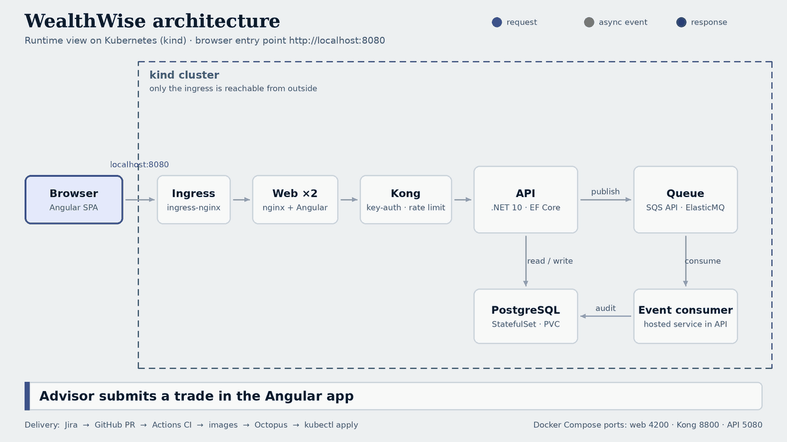

# WealthWise

A wealth-management portfolio platform that runs entirely on Windows **WSL2 / Ubuntu**. Advisors see each account's allocation against its mandate, preview rebalancing trades, place orders, and watch trade events flow through a queue into an audit trail.

It exercises a full enterprise delivery stack: .NET, Angular, SQL, API management, event-driven integration, containers and Kubernetes, CI/CD, and agile practice with Jira and Confluence.



## Ports at a glance

| Where | URL | What |
| --- | --- | --- |
| Docker Compose | http://localhost:4200 | Web app (nginx + Angular) |
| Docker Compose | http://localhost:8800 | Kong gateway (needs the `apikey` header) |
| Docker Compose | http://localhost:5080 | API direct, for debugging; `/openapi/v1.json` |
| Docker Compose | localhost:5432 / :9324 | PostgreSQL / SQS-compatible queue |
| Kubernetes (kind) | http://localhost:8080 | Web app through the ingress (the only external entry) |
| Kubernetes smoke test | localhost:8801 | Temporary port-forward to Kong (kept off 8800 so it never clashes with Compose) |

Kong uses **8800**, not 8000, because 8000 is commonly taken (Splunk, Django and others). Override with `KONG_PORT=9000 docker compose up -d`.

## Quick start (Docker Compose)

```bash
# in Ubuntu on WSL2, from the repo root (keep it under ~ rather than /mnt/c for speed)
make setup     # .NET 10 SDK, Node 22, jq; checks Docker (idempotent)
make up        # builds and starts postgres, queue, api, kong, web (first build can take a while)
make smoke     # curl through the gateway: 401 without key, trade, 422, queue -> audit
make api-test  # 15 xUnit tests, no Docker needed
```
Open **http://localhost:4200**. Place a trade on a portfolio, then check the **Activity** page.

No Docker? Lite mode uses an in-memory database with no gateway or queue:
```bash
make dev-lite-api    # terminal 1
make dev-lite-web    # terminal 2, then http://localhost:4200
```
`make help` lists every target.

## Run it on Kubernetes (kind)

```bash
make down          # stop the compose stack first
make k8s-setup     # kubectl + kind into ~/.local/bin (no sudo)
source ~/.bashrc
make k8s-up        # cluster, ingress-nginx, build + load images, deploy
make k8s-smoke     # same end-to-end checks, via a port-forward to Kong on :8801
```
Open **http://localhost:8080**. Other targets: `k8s-status`, `k8s-logs APP=kong`, `k8s-deploy` (after code changes), `k8s-down`.

Scale once healthy: `kubectl -n wealthwise scale deploy/api --replicas=3`. The consumers compete for queue messages and the audit write is idempotent, so extra replicas do not duplicate rows. `make k8s-up` switches your kubectl context to `kind-wealthwise`; switch back with `kubectl config use-context docker-desktop` if you use Docker Desktop's cluster.

Details and troubleshooting: `docs/confluence/07-kubernetes.md`.

## Troubleshooting (most likely first)

| Symptom | Cause and fix |
| --- | --- |
| Smoke test step 1 gets a `3xx` instead of `401` | Another program owns the port. Check `curl -i localhost:8800/api/portfolios` and `ss -ltnp \| grep :8800`; pick another with `KONG_PORT`. |
| Smoke test fails with curl error 56 right after startup | Kong was still starting; the script now waits (step 0). Re-run `make smoke`. |
| `kind load` fails with `ctr images import ... --all-platforms` | Docker 28/29 containerd image store. `scripts/k8s.sh` imports a single-platform archive instead. |
| Pods stay `ContainerCreating` for many minutes | Image pulls inside the node are slow. Third-party images are preloaded from the host cache; the ingress controller still pulls once. Waits are 15 minutes. |
| `kong` pod `OOMKilled` / `CrashLoopBackOff` | nginx started one worker per host CPU. The manifest pins 1 worker and a 1 Gi limit. |
| Ingress apply fails with `connection refused` on `ingress-nginx-admission` | Flaky admission webhook on kind/WSL2. The script waits for the controller and removes the webhook (local dev only). |
| `libgssapi_krb5.so.2` message in API logs | Harmless: Npgsql probes for Kerberos; password login does not need it. |

## What is where

| Path | What |
| --- | --- |
| `api/src/WealthWise.Domain` | Aggregates, valuation, rebalance strategies. No dependencies. |
| `api/src/WealthWise.Application` | Use cases and ports |
| `api/src/WealthWise.Infrastructure` | EF Core + PostgreSQL, price feed, SQS adapter, consumer |
| `api/src/WealthWise.Api` | Minimal API, OpenAPI at `/openapi/v1.json` |
| `api/tests` | xUnit domain tests and API integration tests (in-memory database) |
| `web` | Angular 19 standalone app, signals, lazy routes |
| `gateway/kong.yml` | Key auth, rate limiting, CORS, correlation id |
| `k8s` | Kustomize manifests and kind cluster config |
| `.github/workflows` | `ci.yml` (build, test, compose smoke, kind smoke) and `release.yml` (images, then Octopus) |
| `deploy/octopus` | Optional local Octopus Deploy server |
| `docs/agile` | Jira setup guide and an importable backlog CSV |
| `docs/confluence` | Architecture, ADRs, API guidelines, runbook, Kubernetes notes, retro template |
| `scripts/make-architecture-gif.py` | Regenerates the animated diagram (`pip install pillow`) |

## Mapping to the role

| Requirement | Where to see it |
| --- | --- |
| .NET, Angular, JavaScript/TypeScript, database | `api/`, `web/`, PostgreSQL schema from `WealthWiseDbContext` |
| OOP, design patterns, data modelling | Aggregate root, Strategy + Factory, Decorator, Repository, idempotent consumer (see ADRs) |
| Testing and refactoring | `api/tests`, pure-function `Valuator`, ports that make infrastructure swappable |
| Source control, build automation, deployment | GitHub Actions, Dockerfiles, Kubernetes manifests, Octopus flow in `docs/confluence/05-release-runbook.md` |
| API management and API-led architecture | Kong in front of the API, OpenAPI contract, `docs/confluence/04-api-guidelines.md` |
| AWS containers and serverless | Container images and probes are ECS/EKS-ready; the SQS consumer moves to Lambda unchanged (backlog S19, S20) |
| Responsive, semantic, accessible front end | Landmarks, labelled form controls, `role="img"` with text on charts, reduced-motion, mobile layout |
| Financial services domain | Cost basis, drift against mandate, rebalancing policies, trade validation, audit trail |
| Agile, Jira, Confluence | `docs/agile/` and `docs/confluence/` |

## Notes and honest limits
- Prices are simulated and the securities are generic ETFs; nothing here is market data or investment advice.
- The gateway key (`dev-web-key`) is a demo secret. nginx injects it so it never ships in the JavaScript.
- Business-rule rejections (422, 404, 409) are logged at Information/Warning; only unexpected exceptions log as errors.
- Events are published after commit (at-least-once). ADR-0002 explains the gap and the planned outbox.
- Schema is created with `EnsureCreated`. Switch to EF migrations before a real deployment.
- The API targets `net10.0`; change `TargetFramework` in `api/Directory.Build.props` and the Docker base images to use another SDK.
- Jira and Confluence are free cloud products, so they are the only pieces outside WSL.
